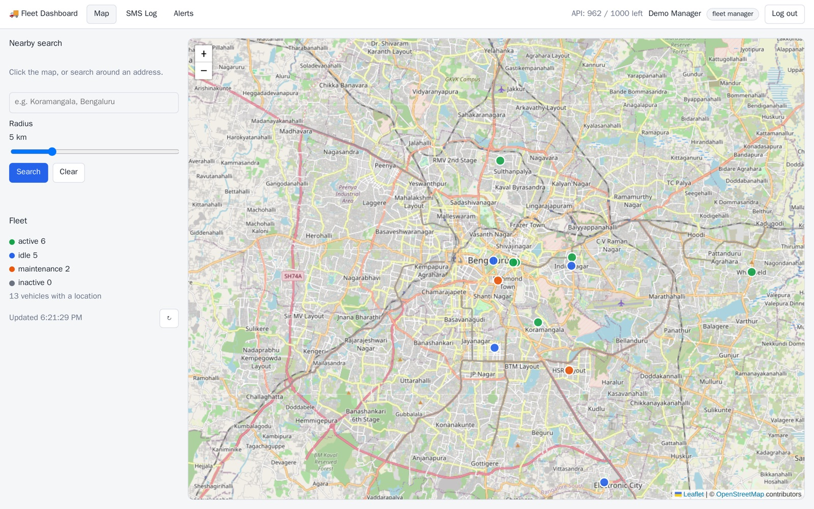
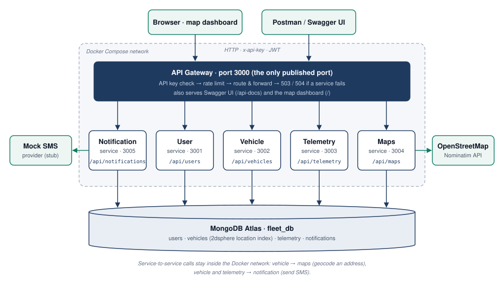
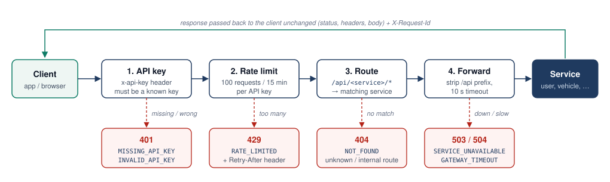
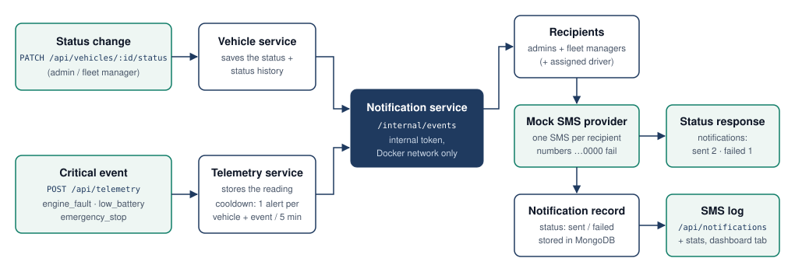
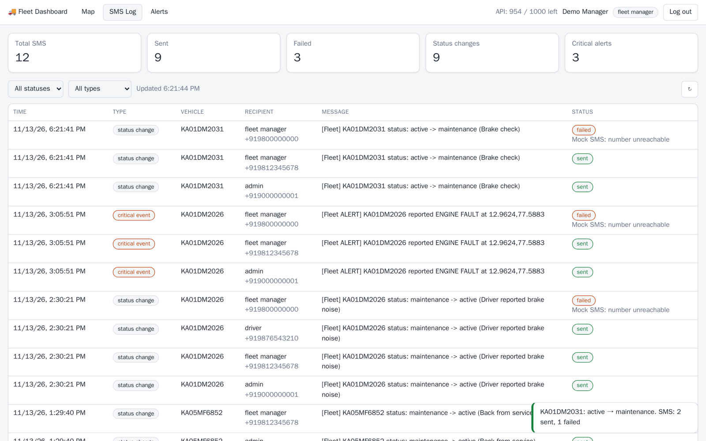
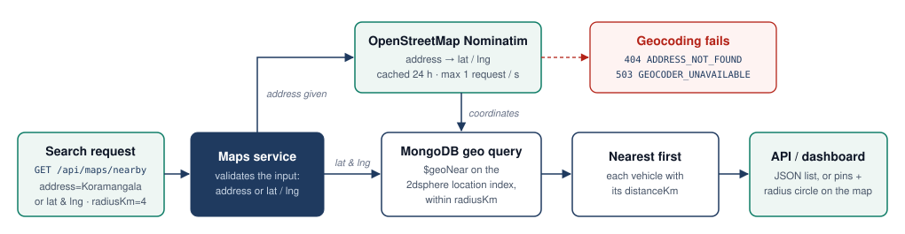
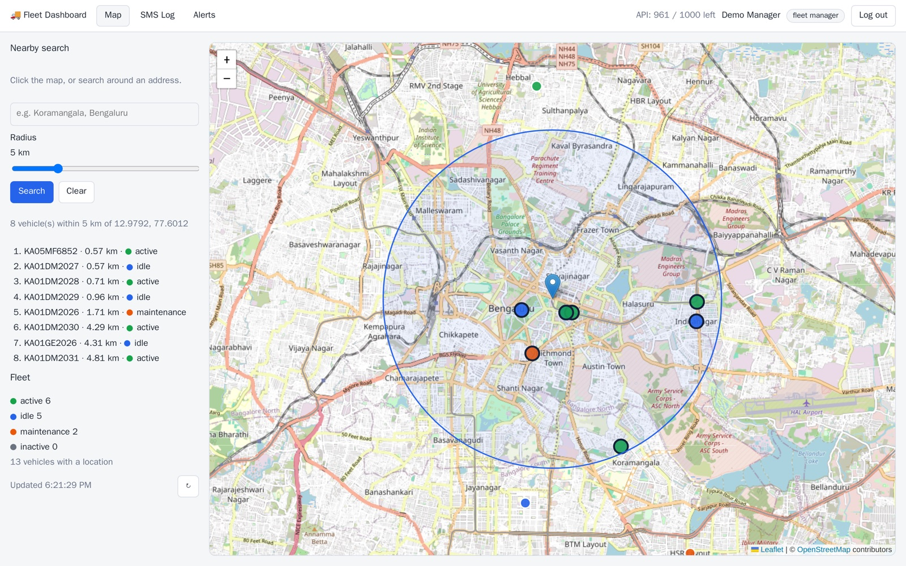
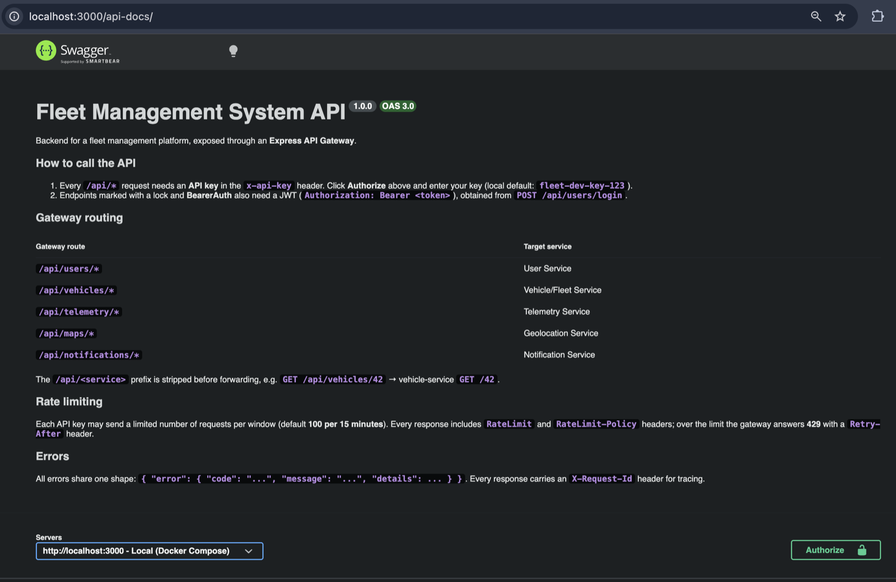

# Fleet Management System

Backend for a fleet management platform: an Express **API Gateway** in front of five microservices, with
OpenStreetMap geolocation, mock SMS notifications, Swagger docs, a map dashboard and a Mocha/Chai test suite.
Everything runs in Docker.



## Features

- **API Gateway:** API key check, rate limiting (100 requests / 15 min per key), routing to five services, 503/504 when a service is down or slow
- **Users & roles:** JWT login; `admin`, `fleet_manager` and `driver` roles
- **Vehicles:** CRUD, status changes with history, admin-only delete
- **Telemetry:** GPS and sensor readings; critical events (engine fault, low battery, emergency stop) send SMS alerts
- **Geolocation:** address ↔ coordinates via OpenStreetMap Nominatim; vehicles within X km, nearest first
- **SMS notifications:** mock SMS provider, with every message stored as `sent` / `failed`
- **Dashboard:** Leaflet map with nearby search, SMS log and alerts
- **Docs & tests:** Swagger UI at `/api-docs`, 214 Mocha/Chai tests

## Architecture



Only the gateway (port 3000) is exposed. The services talk to each other over the Docker network.

| Gateway route          | Service              | Port |
| ---------------------- | -------------------- | ---- |
| `/api/users/*`         | User Service         | 3001 |
| `/api/vehicles/*`      | Vehicle Service      | 3002 |
| `/api/telemetry/*`     | Telemetry Service    | 3003 |
| `/api/maps/*`          | Geolocation Service  | 3004 |
| `/api/notifications/*` | Notification Service | 3005 |

Every `/api/*` request goes through the same pipeline:



## Getting Started

**Prerequisites:** Docker Desktop (Compose v2) and a MongoDB Atlas cluster (the free M0 tier works). See
[MongoDB Atlas setup](docs/mongodb-atlas-setup.md).

In `.env`, set `MONGO_URI`, `JWT_SECRET`, `INTERNAL_SERVICE_TOKEN` and the `ADMIN_*` values.

```bash
git clone https://github.com/UditNayak/fleet-management-system.git
cd fleet-management-system
cp .env.example .env

docker compose up -d --build                      # gateway + 5 services
curl http://localhost:3000/health/services

docker compose --profile tools run --rm seed      # demo users + vehicles
docker compose --profile tools run --rm simulate  # optional: moving vehicles (Ctrl+C)
```

| What       | URL                                                     |
| ---------- | ------------------------------------------------------- |
| Dashboard  | http://localhost:3000                                   |
| Swagger UI | http://localhost:3000/api-docs                          |
| API        | `http://localhost:3000/api/...` with `x-api-key` header |

The local API key is `fleet-dev-key-123`. Demo logins created by the seed script:
`demo.manager@fleet.dev` / `Manager@123` (fleet manager) and `demo.driver@fleet.dev` / `Driver@123` (driver).
The admin account comes from the `ADMIN_*` values in `.env`.

```bash
# Log in, then call a protected endpoint
curl -X POST http://localhost:3000/api/users/login \
  -H "x-api-key: fleet-dev-key-123" -H "Content-Type: application/json" \
  -d '{"email":"demo.manager@fleet.dev","password":"Manager@123"}'

curl "http://localhost:3000/api/maps/nearby?address=Koramangala&radiusKm=4" \
  -H "x-api-key: fleet-dev-key-123" -H "Authorization: Bearer <token>"
```

**Postman:** import `postman/fleet-management.postman_collection.json`. It logs in and creates the demo data by
itself, so any request can be run on its own.

## SMS Notifications



A status change notifies admins, fleet managers and the assigned driver. A critical event notifies admins and
fleet managers, at most once per vehicle and event every 5 minutes. The mock provider writes each SMS to the
notification-service log; numbers ending in `0000` fail on purpose.



## Nearby Search



`GET /api/maps/nearby` takes `lat` + `lng` or an `address`, plus `radiusKm`. Nominatim is called at most once
per second and its answers are cached for 24 h. Vehicles registered with only an address get their
coordinates the same way.



## API Docs

All endpoints are documented in [`docs/openapi.yaml`](docs/openapi.yaml), served with Swagger UI at
`/api-docs`. Click **Authorize** to enter the API key and a JWT.



## Tests

Tests run in Docker against a throw-away MongoDB container (never Atlas). Nominatim is stubbed with Sinon.

```bash
docker compose --profile test run --rm test
docker compose --profile test down            # remove the test database
```

| File                                  | Flow                                         |
| ------------------------------------- | -------------------------------------------- |
| `test/01-auth.test.js`                | User login & JWT verification                |
| `test/02-vehicles.test.js`            | Vehicle registration & retrieval             |
| `test/03-telemetry.test.js`           | Telemetry submission & storage               |
| `test/04-status-notification.test.js` | Status update & notification triggering      |
| `test/05-rbac.test.js`                | Role-based access control                    |
| `test/06-nearby-geocoding.test.js`    | Nearby search with mocked geolocation        |
| `test/07-gateway.test.js`             | API key verification & rate limiting         |
| `test/08-dashboard.test.js`           | Dashboard files, security headers, simulator |

## Other Commands

```bash
docker compose --profile tools run --rm lint                     # ESLint + Prettier
docker compose logs -f notification-service                      # watch the mock SMS
docker compose --profile test --profile tools down -v --rmi all  # remove everything
```

## Project Structure

```
services/   gateway + one folder per service
shared/     config, logging, errors, middleware, models, service clients
public/     dashboard (HTML, CSS, JS)
scripts/    seed data and telemetry simulator
test/       Mocha/Chai tests
docs/       OpenAPI spec, Atlas setup guide, images
postman/    Postman collection
```
